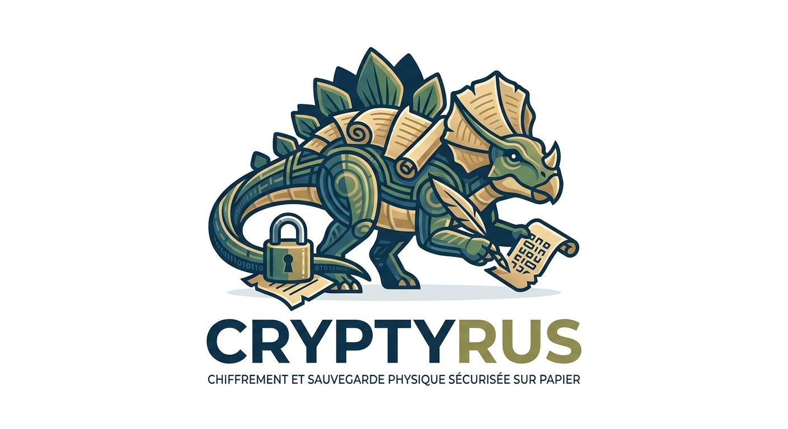

[](https://github.com/debben80/cryptyrus/releases)
[](https://debben80.github.io/cryptyrus/)
[](https://github.com/debben80/cryptyrus/actions/workflows/tests.yml)



# Cryptyrus

**Encryption and secure physical backup on paper.**
Everything happens in your browser: no data (secret or passphrase) ever leaves your device.

---

## Overview

Cryptyrus is a **static and autonomous** web application (a single `index.html` page) that allows you to:

1. **Encrypt a secret** (passwords, recovery keys, sensitive data...) and render it as a **printable QR code**, protected by a **passphrase**.
2. **Split a secret** across multiple sheets using **Shamir's Secret Sharing** (*k-of-n* scheme) without a passphrase: a minimum number of sheets must be gathered to reconstruct the secret.
3. **Recover a secret** by scanning a QR code (via camera) or by pasting the data manually.

Each printed sheet also embeds a **standalone recovery program** (self-contained HTML/JS) allowing you to retrieve the secret even without access to Cryptyrus, simply by opening the file in a browser.

---

## Features

- **Strong encryption**: AES‑256‑GCM, PBKDF2‑SHA‑256 key derivation (600,000 iterations).
- **Shamir's Secret Sharing** (GF(2⁸)) for splitting into *k of n* sheets, with no password required.
- **QR code scanning** via camera (requires HTTPS) or manual data entry.
- **Passphrase entropy estimator** with estimated crack time.
- **Secret size control** (512 bytes recommended, 1,600 bytes maximum) with a real-time counter.
- **Dedicated print layout** (one A4 sheet per QR code), featuring a standalone recovery script and control checksum.
- **Light / Dark theme** (saved locally).
- **Multilingual**: English embedded by default, with additional language packs (French, German, Dutch, Spanish, ...) loaded dynamically.
- **Privacy by design**: Strict Content-Security-Policy (`connect-src 'none'`), no network requests, no transmitted data.

---

## Project Structure

```text
.
├── site/
│   ├── index.html           # Main application (interface + logic)
│   ├── qrcode.min.js        # Local QR code generation library
│   ├── html5-qrcode.min.js  # Local camera QR code scanning library
│   └── lang/                # (Optional) Translation packs (fr, de, nl, es, ...)
│       ├── fr.js
│       ├── de.js
│       ├── nl.js
│       └── es.js
├── tests/
│   └── cryptyrus.spec.mjs   # Playwright E2E and unit test suite
```

> The `qrcode.min.js` and `html5-qrcode.min.js` files must be present **in the same folder** as `index.html`: the application loads no remote dependencies (CSP `script-src 'self'`).

---

## Usage

1. Place `index.html`, `qrcode.min.js`, and `html5-qrcode.min.js` in the same folder (optionally add the `lang/` folder for translations).
2. Open `index.html` in a modern browser (ideally served over **HTTPS** if you want to use camera scanning).
3. Choose a tab:
   - **Single sheet**: Enter a label, the secret to protect, and a passphrase, then generate and print the sheet.
   - **Split across sheets**: Define the total number of sheets and the required threshold, then generate and print the sheets (store them in separate locations).
   - **Recover a secret**: Scan or paste the data from one (or more) sheet(s), then enter the passphrase if required.

---

## Deployment

The application is purely static (HTML/CSS/JS) and can be served by any web server (Nginx, Apache, BusyBox httpd, etc.) or hosted online. Camera QR code scanning requires a secure context (**HTTPS**); without it, manual data entry remains fully available.

The project includes a minimalist `Dockerfile` based on `busybox`, which serves static files via `busybox httpd` under a non-root user.

```yaml
services:
  cryptyrus:
    image: ghcr.io/debben80/cryptyrus:latest
    container_name: cryptyrus
    restart: unless-stopped
    ports:
      - "8080:8080"
    read_only: true
```

---

## Automated Testing & CI/CD

Cryptyrus features a robust end-to-end test suite built with **Playwright**, running automatically via **GitHub Actions** on every push, pull request, manual dispatch, or release publication.

The test suite covers:
- Security warnings and entropy confirmation dialogs.
- Single-sheet (`QRS1 v1`) and Shamir split (`QRS1 v2`) full cycles.
- Unicode NFC/NFD cross-platform passphrase normalization edge cases.
- Standalone HTML recovery script execution (testing both single sheets and Shamir shares).
- Light/Dark theme toggling.

---

## Security

- **Single sheet**: AES‑256‑GCM + PBKDF2 (SHA‑256, 600,000 iterations) — the passphrase is the sole protection for the secret.
- **Shamir split**: No passphrase is needed; security relies on the physical separation of the sheets; a single sheet reveals nothing.
- A **checksum** (truncated SHA‑256 fingerprint) is printed on each sheet to verify it was copied without error — it cannot be used to retrieve the secret.
